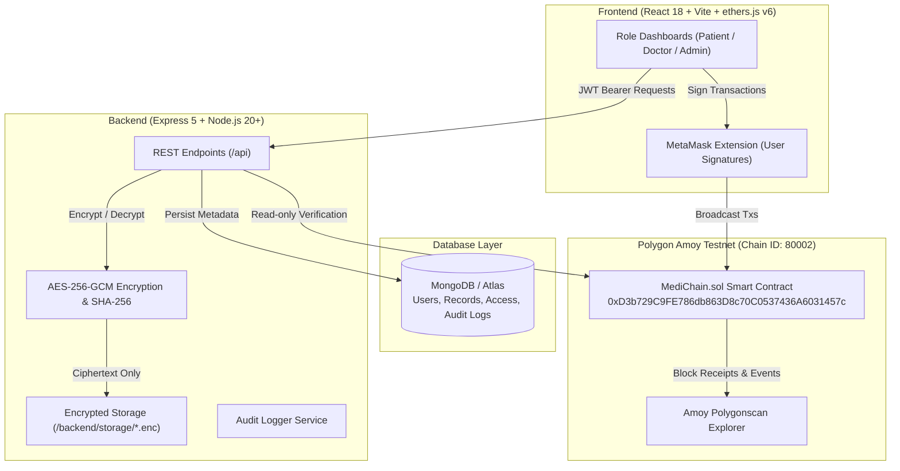

# MediChain — Blockchain-Based Secure Health Record Sharing and Access Control System

> **Capstone Project** | Stack: React 18 + Vite + Bootstrap · Node.js 20+ + Express + MongoDB · Solidity 0.8.24 + Hardhat + ethers.js v6 · Polygon Amoy Testnet (Chain ID 80002)

---

## 1. Project Overview

MediChain is a decentralized, cryptographically secure Electronic Health Record (EHR) management system. It solves the critical triad of healthcare privacy: **patient sovereignty**, **tamper evidence**, and **instant revocation of doctor access**.

### Core Pillars
- **Zero Plaintext Storage**: All medical files (PDF, JPEG, PNG ≤ 10 MB) are encrypted on the backend disk using **AES-256-GCM** before touching storage. Unencrypted records never exist at rest.
- **On-Chain Hash Anchoring**: Only the SHA-256 hash of the original document and access control states are anchored on the **Polygon Amoy testnet**. No PHI (Protected Health Information) is ever recorded on the blockchain.
- **Dual-Barrier Access Control**: A doctor can only access and decrypt a patient's records if:
  1. The doctor has been vetted and verified on-chain by the Admin (`verifiedDoctors[doctor] == true`), **AND**
  2. The patient has explicitly granted on-chain consent via MetaMask (`hasAccess(patient, doctor) == true`).
- **Instant Revocation**: When a patient revokes access on-chain, read and download privileges are terminated immediately with zero latency.
- **Client-Side Signatures Only**: The backend operates in a read-only capacity with the blockchain. All transactions are cryptographically signed by users via MetaMask.

---

## 2. Architecture & Data Flow



### ASCII Flow
```
┌─────────────────────────────────────────────────────────────────┐
│                    FRONTEND (Vite + React 18)                   │
│  Patient / Doctor / Admin dashboards · MetaMask (ethers v6)     │
└───────────────────┬───────────────────────────────┬─────────────┘
                    │ REST API (JWT)                │ On-chain tx
┌───────────────────▼──────────────────────────┐    │ (User signs)
│                    BACKEND (Node 20 + Express)│    │
│  Auth · Records (AES-256-GCM) · Audit Log    │    │
│  Read-only event validation via RPC Provider │    │
└─────────┬────────────────────────────┬───────┘    │
          │ Mongoose                   │ Read-only  │
┌─────────▼─────────┐        ┌─────────▼────────────▼─────────────┐
│  MongoDB Database │        │     MediChain.sol (Polygon Amoy)   │
│  Users, Requests, │        │     File hashes · Doctor verify    │
│  Records, Audits  │        │     Access permissions on-chain    │
└───────────────────┘        └────────────────────────────────────┘
```

---

## 3. Live Deployment Details

- **Network**: Polygon Amoy Testnet
- **Chain ID**: `80002` (`0x13882` hex)
- **Contract Address**: [`0xD3b729C9FE786db863D8c70C0537436A6031457c`](https://amoy.polygonscan.com/address/0xD3b729C9FE786db863D8c70C0537436A6031457c)
- **Deployer / Owner**: `0x443E3C91c81cE14a2f65E5829eD0EE289Ab83464`
- **Deployment Transaction**: [`0x44dc7f633605c11a2d349026ccd7e75ab8d7e471edf14313e0e402f8fefe18ac`](https://amoy.polygonscan.com/tx/0x44dc7f633605c11a2d349026ccd7e75ab8d7e471edf14313e0e402f8fefe18ac)

---

## 4. Prerequisites

| Tool | Recommended Version | Purpose |
|------|--------------------|---------|
| **Node.js** | `>= 20 LTS` (Tested on Node 20 & 24) | Runtime environment |
| **npm** | `>= 10` | Dependency management |
| **MongoDB** | `7.x Community` (or MongoDB Atlas / in-memory) | Data persistence |
| **MetaMask** | Latest browser extension | Nonce management and tx signing |
| **Git** | Any modern version | Source control |

---

## 5. Step-by-Step Installation & Setup

### Step 1: Clone Repository
```bash
git clone https://github.com/alefiya12/MediChain-a-Blockchain-Based-Secure-Health-Record-Sharing-and-Access-Control-System.git
cd medichain
```

### Step 2: Install Dependencies
```bash
# 1. Smart contracts
cd blockchain && npm install

# 2. Backend API
cd ../backend && npm install

# 3. Frontend application
cd ../frontend && npm install
cd ..
```

### Step 3: Configure Environment Variables

#### A. Blockchain (`blockchain/.env`)
```bash
cp blockchain/.env.example blockchain/.env
```
Fill in `DEPLOYER_PRIVATE_KEY` (test wallet only) and `AMOY_RPC_URL`.

#### B. Backend (`backend/.env`)
```bash
cp backend/.env.example backend/.env
```
Generate cryptographic keys:
```bash
# Generate JWT_SECRET:
node -e "console.log(crypto.randomBytes(32).toString('hex'))"

# Generate FILE_ENCRYPTION_KEY (must be 64 hex chars = 32 bytes):
node -e "console.log(crypto.randomBytes(32).toString('hex'))"
```
Ensure `PORT=5050` (to avoid macOS AirPlay Receiver port 5000 conflicts).

#### C. Frontend (`frontend/.env`)
```bash
cp frontend/.env.example frontend/.env
```
Set `VITE_API_URL=http://localhost:5050/api` and `VITE_CONTRACT_ADDRESS=0xD3b729C9FE786db863D8c70C0537436A6031457c`.

---

### Step 4: Smart Contract Compilation & ABI Export
```bash
cd blockchain
# Run all unit tests
npx hardhat test

# (Optional: Deploy fresh contract if desired)
# npx hardhat run scripts/deploy.js --network amoy

# Export ABI to backend and frontend
npm run export-abi
cd ..
```

---

### Step 5: Seed Admin Account
```bash
cd backend
npm run seed:admin
cd ..
```
*Creates the system admin account (`admin@medichain.local` / `AdminPassword123!`) linked to the contract owner's wallet.*

---

### Step 6: Start Services

#### Terminal 1 — Backend API
```bash
cd backend
npm run dev
# Running on http://localhost:5050
```

#### Terminal 2 — Frontend Application
```bash
cd frontend
npm run dev
# Running on http://localhost:5173
```

---

## 6. Environment Variables Reference Table

### `blockchain/.env`
| Key | Required | Default / Example | Purpose |
|-----|----------|-------------------|---------|
| `AMOY_RPC_URL` | Yes | `https://rpc-amoy.polygon.technology` | Polygon Amoy JSON-RPC Provider |
| `DEPLOYER_PRIVATE_KEY` | Yes | `<64-hex-chars>` | Deployer/Owner private key (**test funds only**) |
| `POLYGONSCAN_API_KEY` | No | `<optional-api-key>` | For automated contract verification |

### `backend/.env`
| Key | Required | Default / Example | Purpose |
|-----|----------|-------------------|---------|
| `PORT` | Yes | `5050` | Port for backend HTTP server (5050 avoids macOS AirPlay) |
| `MONGO_URI` | Yes | `mongodb://127.0.0.1:27017/medichain` | MongoDB connection URI |
| `JWT_SECRET` | Yes | `<64-hex-chars>` | Secret for signing JWT authentication tokens |
| `JWT_EXPIRES_IN` | Yes | `7d` | JWT session expiration window |
| `AMOY_RPC_URL` | Yes | `https://rpc-amoy.polygon.technology` | RPC for backend read-only receipt verification |
| `CONTRACT_ADDRESS` | Yes | `0xD3b729C9FE786db863D8c70C0537436A6031457c` | Deployed MediChain smart contract |
| `FILE_ENCRYPTION_KEY` | Yes | `<64-hex-chars>` | 256-bit AES-GCM symmetric key for file encryption |
| `FRONTEND_URL` | Yes | `http://localhost:5173` | Allowed origin for CORS headers |
| `ADMIN_EMAIL` | Yes | `admin@medichain.local` | Initial system administrator email |
| `ADMIN_PASSWORD` | Yes | `AdminPassword123!` | Initial administrator password |
| `ADMIN_WALLET` | Yes | `0x443E3C91c81cE14a2f65E5829eD0EE289Ab83464` | Admin wallet address (matches contract owner) |

### `frontend/.env`
| Key | Required | Default / Example | Purpose |
|-----|----------|-------------------|---------|
| `VITE_API_URL` | Yes | `http://localhost:5050/api` | Backend base URL for axios client |
| `VITE_CONTRACT_ADDRESS` | Yes | `0xD3b729C9FE786db863D8c70C0537436A6031457c` | MediChain contract address for MetaMask |
| `VITE_CHAIN_ID` | Yes | `80002` | Target EVM network chain ID (Polygon Amoy) |

---

## 7. User Guide & Role Workflows

### 🏥 1. Patient Role
1. **Registration**: Select **Patient** role. Upon completion, a unique system patient identifier is generated (e.g., `MC-P-000001`).
2. **Wallet Connection**: Connect MetaMask on Polygon Amoy testnet.
3. **Upload Records**:
   - Upload PDF, JPG, or PNG files up to 10 MB.
   - The frontend uploads the file to the backend, which hashes and encrypts it with AES-256-GCM.
   - The user confirms and signs the `registerRecord(recordId, fileHash)` transaction in MetaMask.
4. **Integrity Verification**: Click **Verify** on any uploaded record to re-hash decrypted bytes and compare against the on-chain anchor (`VERIFIED` vs `TAMPERED`).
5. **Access Consent**: Receive access requests from doctors in the **Access Requests** tab. Approve or reject on-chain.
6. **Instant Revocation**: View all authorized practitioners under **Granted Doctors** and revoke access on-chain at any time.

---

### 🩺 2. Doctor Role
1. **Registration**: Select **Doctor** role, providing license number, specialization, hospital, and years of experience.
2. **Approval Gate**: Doctor status starts as `pending`. Searching patients or requesting access is restricted until Admin verification.
3. **Search Patient**: Enter the patient's ID (`MC-P-XXXXXX`) to inspect profile metadata without seeing medical files.
4. **Request Access**: Submit an access request, specifying clinical reasons and signing `requestAccess(patientAddress)` on-chain.
5. **Authorized Inspection**: Once the patient grants consent, view and download decrypted records with full integrity checks.

---

### 🛡️ 3. Admin Role
1. **Login**: Authenticate using administrator credentials.
2. **Doctor Verification Panel**: View all pending doctor registrations.
3. **On-Chain Vetting**: Click **Approve Doctor** to sign `verifyDoctor(doctorAddress)` using the contract owner wallet.
4. **System Audit Trail**: Inspect global platform activity across all patients, doctors, and smart contract events with Polygonscan links.

---

## 8. Verification & Test Suites

The project features a suite of automated unit, integration, and end-to-end tests:

```bash
# 1. Smart Contract Tests (28 passing tests)
cd blockchain && npx hardhat test

# 2. Phase 12 Full 12-Step End-to-End Test Plan (32 passing tests)
cd ../backend && node tests/phase12.test.js

# 3. Phase 11 Hardening, Security & Validation Suite (30 passing tests)
node tests/phase11.test.js

# 4. Phase 10 Audit Trail & Role Visibility Suite (33 passing tests)
node tests/phase10.test.js

# 5. Phase 9 Patient Flows & Verification Suite (28 passing tests)
node tests/phase9.test.js

# 6. Frontend Production Build Check
cd ../frontend && npm run build
```

---

## 9. Troubleshooting & FAQ

| Problem | Cause | Solution |
|---------|-------|----------|
| **Port 5000 in use** | macOS AirPlay Receiver occupies port 5000 | Configured default `PORT=5050` in `.env`. Alternatively, disable AirPlay in macOS System Settings → General → AirDrop & Handoff. |
| **MetaMask Wrong Network** | Connected to Ethereum Mainnet or Sepolia | Click **Switch to Amoy** on the top navigation bar. MediChain will automatically invoke `wallet_switchEthereumChain` / `wallet_addEthereumChain` for Chain ID 80002. |
| **Insufficient POL for Gas** | Wallet balance is 0 | Obtain test POL from [Polygon Faucet](https://faucet.polygon.technology/) or [Alchemy Amoy Faucet](https://www.alchemy.com/faucets/polygon-amoy). |
| **Wallet Mismatch Warning** | Active MetaMask account differs from registered address | Switch to the registered wallet in MetaMask. The app shows a warning banner preventing unintended signing. |
| **Transaction Nonce Desync** | Local nonce is out of sync with testnet | In MetaMask, go to **Settings → Advanced → Clear activity and nonce data**. |
| **RPC Rate Limit (429)** | Public Polygon RPC throttled | Change `AMOY_RPC_URL` in `.env` to an alternative public provider (e.g., `https://polygon-amoy-bor-rpc.publicnode.com` or an Infura/Alchemy endpoint). |

---

## 10. License

This project is licensed under the MIT License for educational and capstone demonstration purposes.
